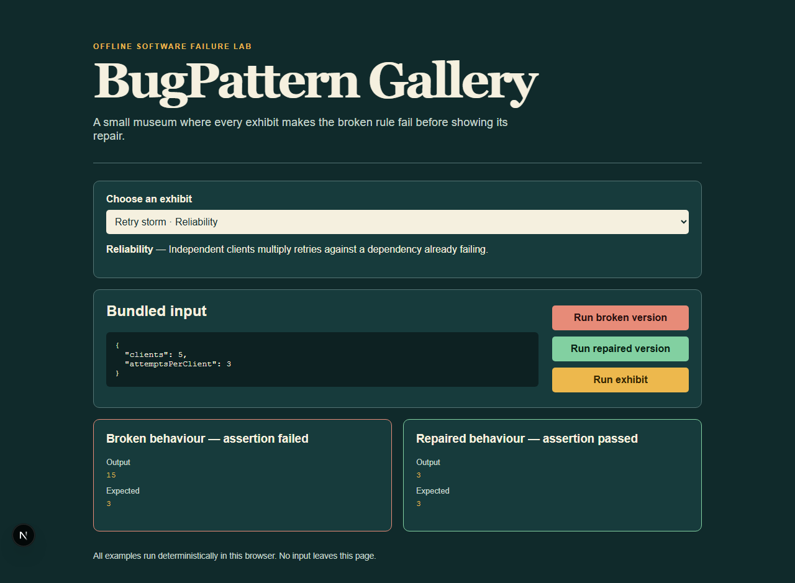

# BugPattern Gallery

> An executable museum of software failure patterns: each exhibit runs a broken rule and its repair side by side.



[](https://github.com/KanadeK/bugpattern-gallery/actions/workflows/ci.yml) [](LICENSE) [](CHANGELOG.md)

BugPattern Gallery turns common bugs into small, inspectable experiments. It is built for students, training teams, engineers, and technical writers who need a reproducible explanation rather than a static anecdote.

- Run the broken and fixed behaviour locally in the browser.
- Inspect the exact assertions and deterministic output.
- Extend the catalogue through validated MDX-backed cases.

## Quick start

```bash
npm ci
npm run dev
```

Open `http://localhost:3000`, choose **Retry storm**, then select **Run exhibit**. The broken run sends 15 requests where the repair sends 3:

```text
bad:   requests=15, passed=false
fixed: requests=3, passed=true
```

## Features

Ten original exhibits cover races, stale cache, time zones, floating point currency, retry storms, null protocol values, idempotency, pagination, Unicode normalization, and configuration drift. Every exhibit has a deterministic input, executable bad and repaired implementations, assertions, an MDX explanation, and offline test coverage.

## Architecture

The pure, network-free runner is in `src/domain/`; the Next.js client is a thin view over it. Content files in `content/cases/` are checked against the runtime catalogue. Releases contain a static `site/` directory ready for any static host. No arbitrary code, external API, telemetry, account, or user data is processed.

## Commands

```bash
npm run verify
npm run demo
npm run package
npm run release-check
```

On systems with Make, equivalent `make verify`, `make demo`, `make package`, and `make release-check` targets are available.

## Non-goals

This is not a production debugger, code execution service, or a catalogue of real incident data. The runner intentionally only evaluates bundled deterministic logic.

## Testing and security

Unit and integration tests exercise case state and invalid inputs; Playwright drives three user journeys; coverage thresholds protect the domain core. Fixture inputs are public, synthetic, and kept in the repository. See [privacy and security](docs/PRIVACY_AND_SECURITY.md).

## Competitor difference

Public-repository sampling found adjacent failure-learning projects but no active project with this exact alternate name and the same offline executable, bad-versus-fixed exhibit model. Details are in [the competitor scan](docs/COMPETITOR_SCAN.md).

## Contributing and roadmap

Read [CONTRIBUTING.md](CONTRIBUTING.md). Next: additional language runtimes and instructor collections without accepting untrusted code.
